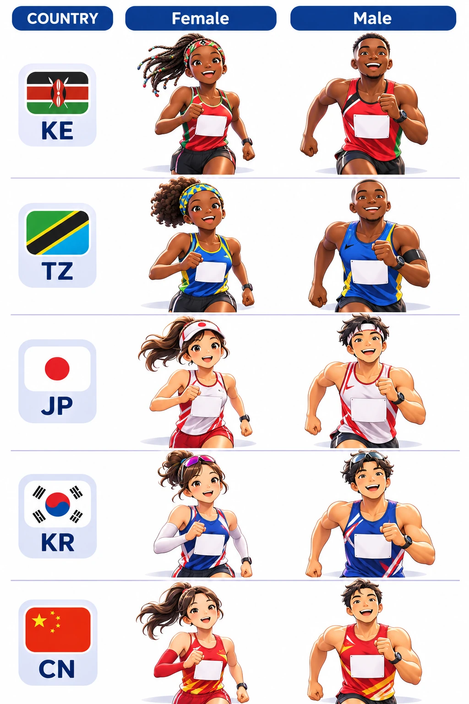
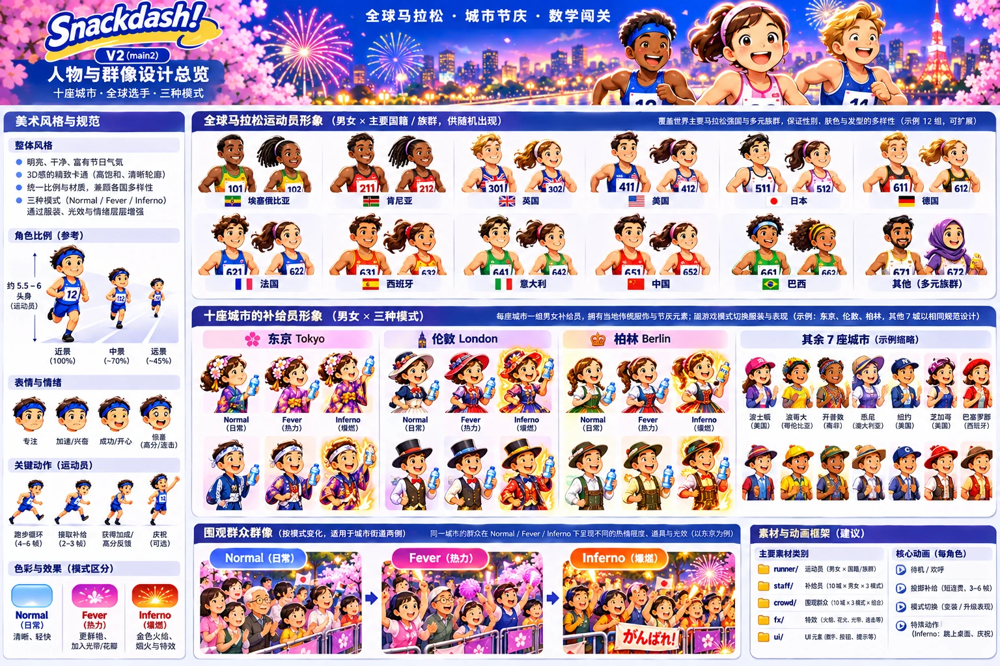
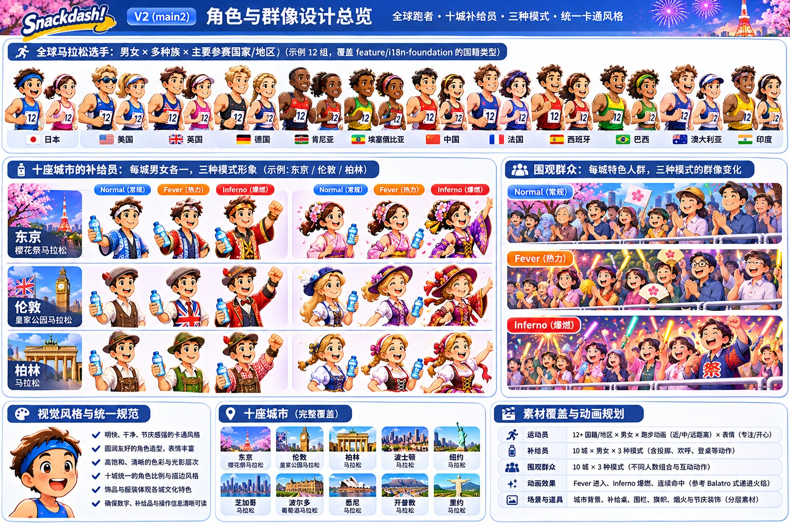
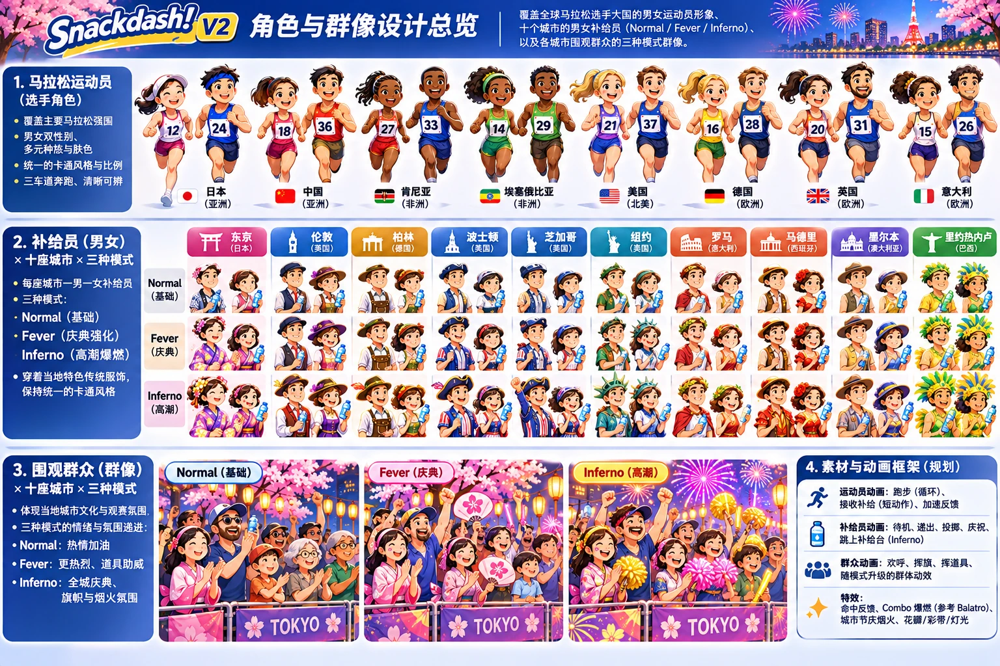
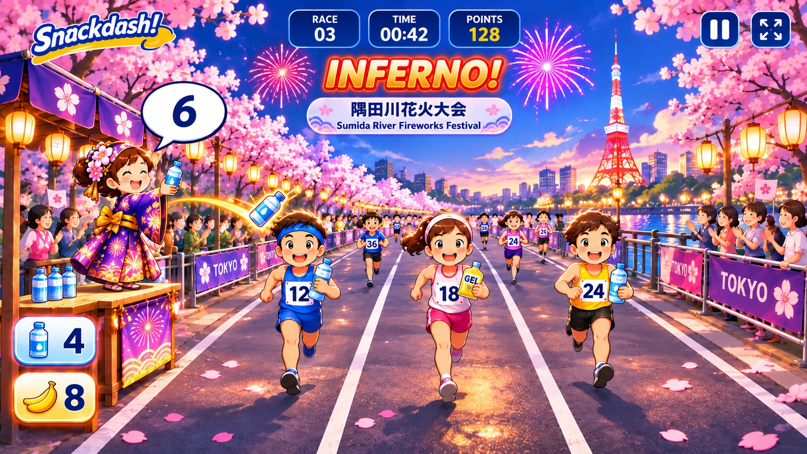

# SnackDash V2 — 人物与节庆素材归档 r01

**基于：** `main2`（commit `da52244d`）  
**保存内容：** 当前确认的五张核心视觉参考，保留**原始 PNG**及**高质量 WebP 预览**。  
**状态：** Concept reference / 待评审。不是生产素材、Sprite Atlas 或正式游戏截图。

## 可直接浏览的图片

### 1. 运动员初版：肯尼亚、坦桑尼亚、日本、韩国、中国

[原始 PNG](originals/runner_cast_KE_TZ_JP_KR_CN.png) · [WebP 预览](optimized/runner_cast_KE_TZ_JP_KR_CN.webp)

**备注：** 仅覆盖11国里的5国；不能把国籍固定成种族或肤色。

### 2. 人物与环境统一卡通风格

[原始 PNG](originals/global_style_moodboard.png) · [WebP 预览](optimized/global_style_moodboard.webp)

**备注：** 概念气氛板；图片中的国别、城市与文字可能存在生成误差，不可作为权威设定。

### 3. 十城男女补给员三模式服装方向

[原始 PNG](originals/volunteer_costume_moodboard.png) · [WebP 预览](optimized/volunteer_costume_moodboard.webp)

**备注：** 服饰可审美参考，不是60套已经完成的原画；文化历史内容需要后续核查。

### 4. 十城观众三模式群像气氛

[原始 PNG](originals/city_crowd_modes.png) · [WebP 预览](optimized/city_crowd_modes.webp)

**备注：** 观众必须始终在护栏后，Normal/Fever/Inferno 的真实逐帧动作尚未制作。

### 5. 东京 Inferno：实体补给＋只有数字的气泡

[原始 PNG](originals/tokyo_inferno_supply_number_only.png) · [WebP 预览](optimized/tokyo_inferno_supply_number_only.webp)

**备注：** 选定的明快节庆卡通气氛与实体投掷补给，补给员手边数字气泡仅含数字；这是横向概念图，不是390×700实际手机游戏截图。

## 已确认的 V2 设计约束

- 正式游戏是 **390×700 竖屏**，三条自然透视的车道，运动员从远方向镜头跑来；左侧玩家操控补给员。
- 补给员有男女两款，每城 Normal/Fever/Inferno 三套服装升级；Inferno 双脚站在**不升高**的原桌面，女性长袍自然垂落、不露腿。
- 投掷的是**真实马拉松补给**（水瓶、能量胶等），不是数字牌；手中已拿物品时，其附近 speech bubble 只显示**数字**，不重复画物品。
- **左下角两格备用补给**保持固定操作位置；背景庆典不得遮挡运动员胸前号码。
- `feature/i18n-foundation` 的 11 个运动员国籍语言档案仍由该分支管理，人物外貌不得由国籍推导。
- 群众在路边护栏后，Normal → Fever → Inferno 按同一群像递进，不能盖住跑道数字。

## 相关规划（从 main2 继承）

- [人物美术规范](../../../docs/main2-character-direction.md)
- [60套补给员服装方案](../../../docs/main2-volunteer-casting.md)
- [30组观众群像](../../../docs/main2-crowd-casting.md)
- [人物/在地化接口](../../../docs/main2-character-i18n-contract.md)
- [112个设计单元索引](../../characters/character-briefs.json)
- [制作审核清单](../../../docs/main2-character-production-checklist.md)

## 发布边界

此分支只新增本目录里的图片及设计文档。不会自动被游戏打包，不修改 `src/`、`tests/`、`scripts/`、`main` 或 `feature/i18n-foundation`。以后从概念稿拆出可编辑角色图层、动画帧与正式图集，需另行审核。
