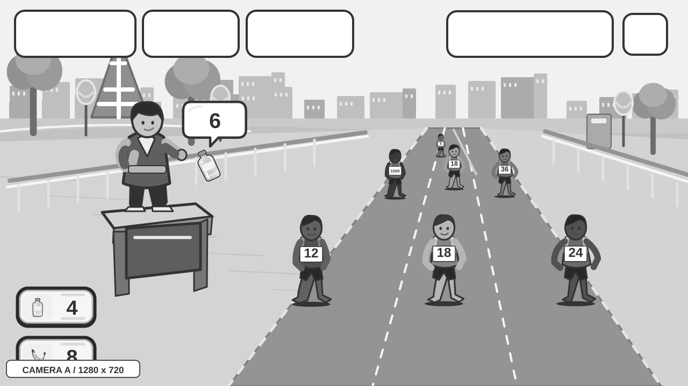
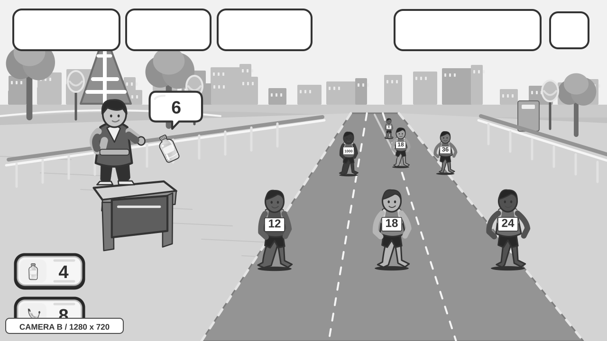
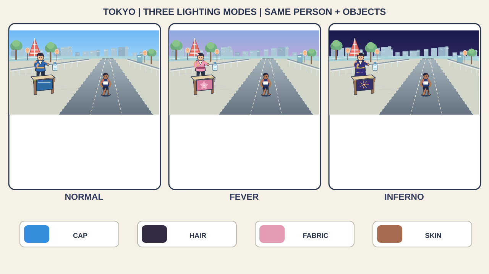
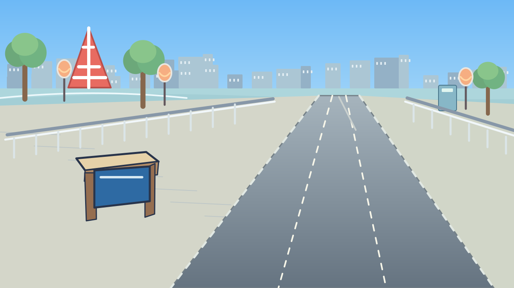
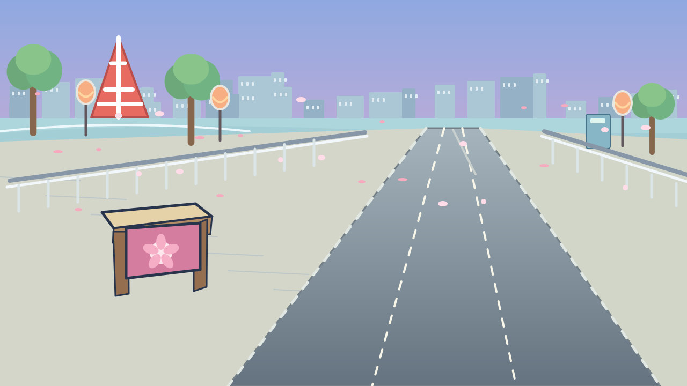
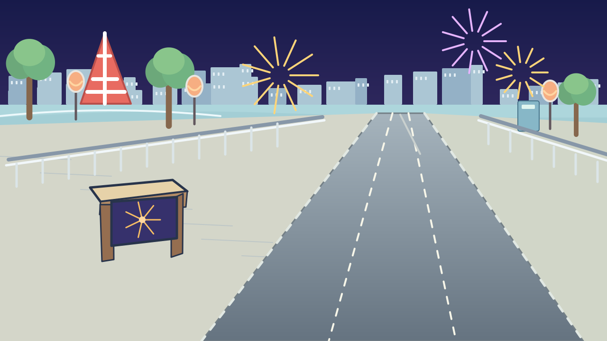
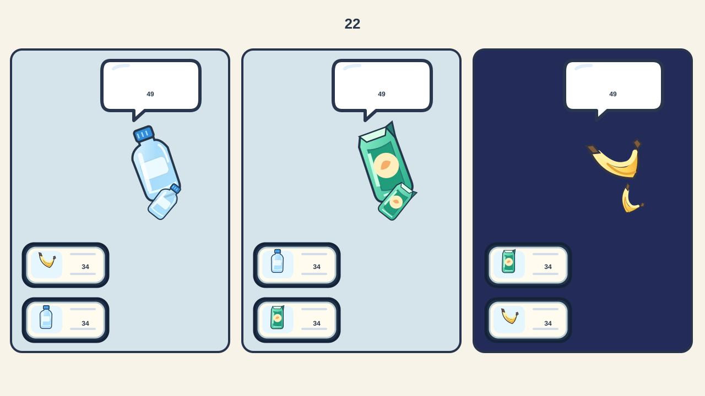
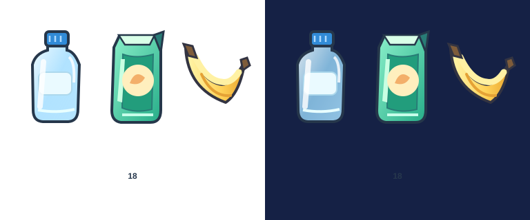

# SnackDash r02 — Tokyo landscape art / steps 01–04

> **Current steps 01–04 rebuild:** [approved-reference-calibrated source art and QA](approved-rebuild-r03/README.md) (2026-11-27). The prior camera A/B SVGs farther down are retained as exploratory history; they are **not** the approved-reference geometry. The latest approved Inferno image is already committed in [the official Tokyo reference set](../../references/tokyo/approved/README.md).

> **2026-11-27 approved references supersede exploratory r02 mockups:** See [the Tokyo reference contract](../../references/tokyo/approved/README.md) and [owner-approved gallery](https://chatgpt.com/space/page_47596f3a8a2881918ad2bd9b7bed05f5). The three original approved images are committed in GitHub; the vector A/B drawings below remain exploratory only.

**Review branch:** `feature/main2-landscape-assets-r02`  
**Source:** `main2@c102ab0329d696199161ba0747633b721e82c4e9`  
**Current stage:** **review**, *not* approved/runtime-integrated.  
**Scope:** 1280 × 720 horizontal prototype art; no game code modified.

## Step 01 — camera choice and responsive readout

Candidate A gives more foreground station presence; candidate B shrinks the station and shifts the road perspective to give more space to the leftmost lane. A is the **provisional** master and awaits your approval.

| A | B |
| --- | --- |
|  |  |

[640 × 360 preview](01_camera_A_thumbnail_640x360.svg) · [wide 19.5:9 preview](01_wide_19_5x9.svg) · [narrow 4:3 letterboxed preview](01_narrow_4x3_letterboxed.svg) · [Coordinate JSON](../../source/camera/r02/camera_coordinates.json).

## Step 02 — consistent character, lighting and supplies

Same runner, staff silhouette, bottle and guardrail across Normal/Fever/Inferno. Palette, outlines and material rules live at [tokyo_palette.json](../../source/style/r02/tokyo_palette.json). The separate generative style exploration is *not* misrepresented as a layered sprite source.

## Step 03 — modular Tokyo environment

| Normal | Fever | Inferno |
| --- | --- | --- |
|  |  |  |

Reusable modules: [street sources](../../source/street/tokyo/shared), [normal](../../source/street/tokyo/normal), [fever](../../source/street/tokyo/fever), [inferno](../../source/street/tokyo/inferno), [fixed table](../../source/station/tokyo/shared), [mode-specific table fronts](../../source/station/tokyo).

## Step 04 — independent real-alpha objects and empty UI parts

Water, gel and banana each have [SVG masters](../../source/supply) and [individual transparent PNG exports](../../exports/supply). Their numerals are not part of any object. The empty bubble and slot each also have [SVG](../../source/ui) and [PNG](../../exports/ui). The bubble must show **only one number** at runtime. The left corner displays **exactly two** reserve slots (icon + value, one in each).

## Review documents

- [Step 01–03 source notes](README_steps_01_03.md)
- [Step 04 component notes](README_step_04.md)
- [Asset manifest](manifest_steps_01_04.json)
- [QA and pending items](QA_steps_01_04.md)
- [Full r02 playbook](../../../docs/SnackDash_V2_Landscape_Asset_Playbook.md)

**No runtime sprite bindings, scripts, new math supply types, localization strings or gameplay code were changed.** The prototype source is editable vector artwork, not the finished character-animation package. The art still requires your visual approval and a later mobile readability test before it is marked produced/tested.
