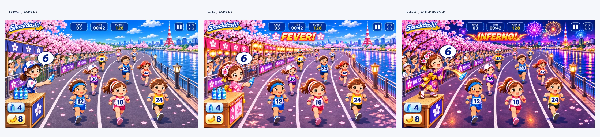
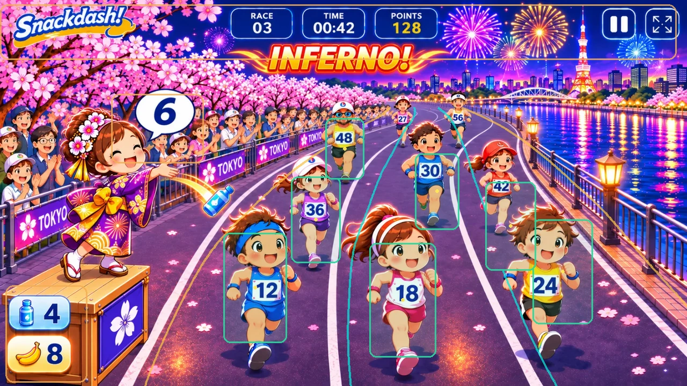
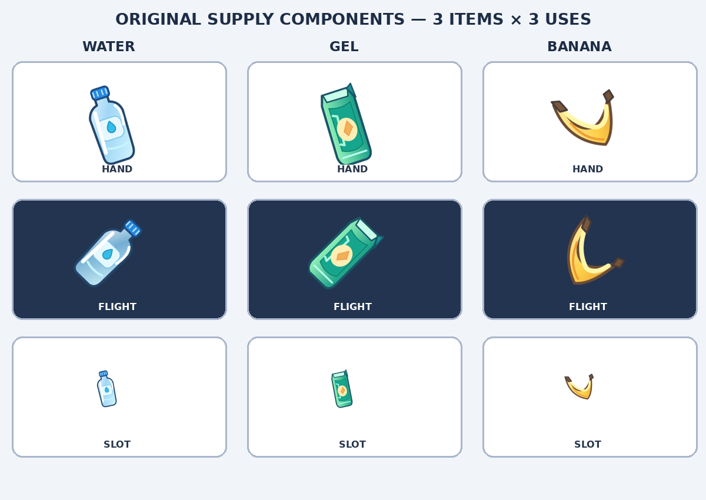

# SnackDash Tokyo — approved-reference rebuild, steps 01–04

**Branch target:** `feature/main2-landscape-assets-r02` (the existing user-authorized branch)  
**Design basis:** three user-approved Tokyo images, with **revised Inferno `1000084030.png`**.  
**Status:** derived source and previews **for review**. The original reference images remain the *only owner-approved finished visuals*; new derivatives are not yet owner-approved production art.

## Read this before opening the new files
The existing `assets/previews/landscape-r02/` folder contains exploratory r02 vectors that diverged from the owner-approved camera. **This `approved-rebuild-r03/` subfolder supersedes those exploratory coordinate/station design assumptions.** The actual three approved master images remain under `assets/references/tokyo/approved/`.

## 01 — Matched camera and testable geometry
* `01_camera_A_1280x720.png`: approved-aligned camera draft; `01_camera_B_1280x720.png`: small width-stress alternative, NOT a new approval.
* `01_approved_{normal,fever,inferno}_geometry_overlay.webp`: actual approved screenshots with road trace, seven selectable hit areas and HUD/hand reserve exclusion.
* `01_approved_safe_zones.webp`, `01_640x360_readability.webp`, `01_wide_19_5x9_center_unchanged.webp`, `01_narrow_4x3_letterboxed.webp`.
* Editable PCHIP control points, runner placements, numeric examples and hitboxes: `assets/source/approved-rebuild-r03/camera/approved_camera_coordinates.json`; road SVG: `approved_road_geometry.svg`.

**Interpretation:** The road traces and uniform runner-size function were manually matched to the approved images, in screen space; they are a deterministic layout model, **not** a recovered real-world lens or an independently verified 3D calibration. Foreground and background runners use the *same* continuous sizing function. The seven selectable runners are 12, 18, 24, 36, 30, 42 and 48; farther figures remain visible but non-selectable until approaching. Click areas are separate from drawn characters and must undergo mobile touch QA. One medium bib should also be tested with `1000` (the coordinate file records it).

## 02 — Style from approved originals, without inventing new characters
* `02_approved_style_scale_sheet.webp`: direct crops of all three original images, colour comparisons and context.
* `approved_palette.json` and `approved_character_ratio.json`: outlines, bib and material samples, fixed chibi silhouette policy and numeric readability constraints.

The attached approved artwork is an **appearance reference**. Independent runner and volunteer finished rigs belong to steps 05–07; the schematic geometry silhouettes are not falsely labelled as completed character art.

## 03 — Same Tokyo road and desk in three modes
* An original, newly drawn **empty Tokyo plate** (no runner, staff, UI, table) has been generated for layout review under `assets/source/approved-rebuild-r03/street/tokyo/shared_empty_environment_plate.webp`; this is **not** a pixel-identical reconstruction of the owner's approved screenshots.
* The plate is losslessly separable into **skyline, left street, road and right river** raster regions, each full-canvas RGBA (lossless WEBP with alpha, pixel-exact when recomposited); their alpha-composite reassembles the original plate exactly, proven in QA JSON. These are *coarse layout segmentation masks*, not finely isolated individual cherry blossoms or hand-retouched rail segments.
* Matching mode-coloured plates `normal/fever/inferno_empty_environment_plate.webp` use the same geometry; `ambient_fever.svg` and `ambient_inferno.svg` are independent decorations.
* Editable street guides `approved_road_geometry.svg`, `editable_rail_guides.svg` and a truly separated **table rear legs, table frame, table top, mode-specific table fascia** under `source/approved-rebuild-r03/station/tokyo`.
* `03_tokyo_{normal,fever,inferno}_station_occlusion_review.png` are compositing-layout images with deliberately schematic staff proxies to demonstrate **rear-to-front occlusion**, not finished character art. Normal/Fever staff are behind the table; Inferno weight falls on the **same tabletop**.

## 04 — Independent physical supplies
* 3 original, editable SVG masters: water bottle, tear-notch gel pouch and curved banana.
* Each has `hand`, `flight` and `slot` derivatives in editable SVG and true-alpha PNG (9 PNG files; no brand, numbers or labels baked into physical objects).
* Empty number-only bubble, empty reserve-slot base (2 more RGBA PNG files) and separate rear grip / front thumb SVGs.
* `04_supplies_alpha_contact_sheet.png` and three `04_*_assembly_review.png` test 6, 12, 13 in bubble, 4/8 in **exactly two slots** and one flying physical object. Gel is not yet in runtime math types.

## Review findings and guardrails
* No new image is claimed as approved merely by being in the approved-rebuild folder.
* Approved masters remain unchanged, including the most recently replaced Inferno.
* No changes to `src/`, game logic, i18n or asset integration.
* On-device readability, real touch performance, alpha-fringing across GPU blending, collision timing, movement and actual rigged staff/runner sprite animations are **NOT TESTED**.
* Existing approved screenshots have highly detailed art; these new deterministic SVGs and geometry proxies are technical layout sources for the artist and engineering handoff. Finish art must match the approved master before runtime use.

## Reading the exported review previews
All large review snapshots are WebP for efficient GitHub display; camera gray candidates and actual supply sprites remain PNG. The source street-region layers are cropped, lossless alpha WebP plus `street/tokyo/layers/region_layers_manifest.json` pixel offsets; all five fragments reproduce the shared source plate exactly. `make_assets.py` can regenerate editable SVG and the unoptimised review PNGs; conversions to WebP are an archive optimisation, not changes to the approved original screenshots.

### Quick review links

| View | Asset |
|---|---|
| Original visual reference |  |
| Camera & clickable regions |  |
| Geometry / table occlusion |  |
| Supplies / transparency |  |

**Reference hierarchy:** `assets/references/tokyo/approved/` originals are authoritative; all new environment plates, vector silhouettes, UI tests and empty scene images in this folder are derived, review-only candidates.
