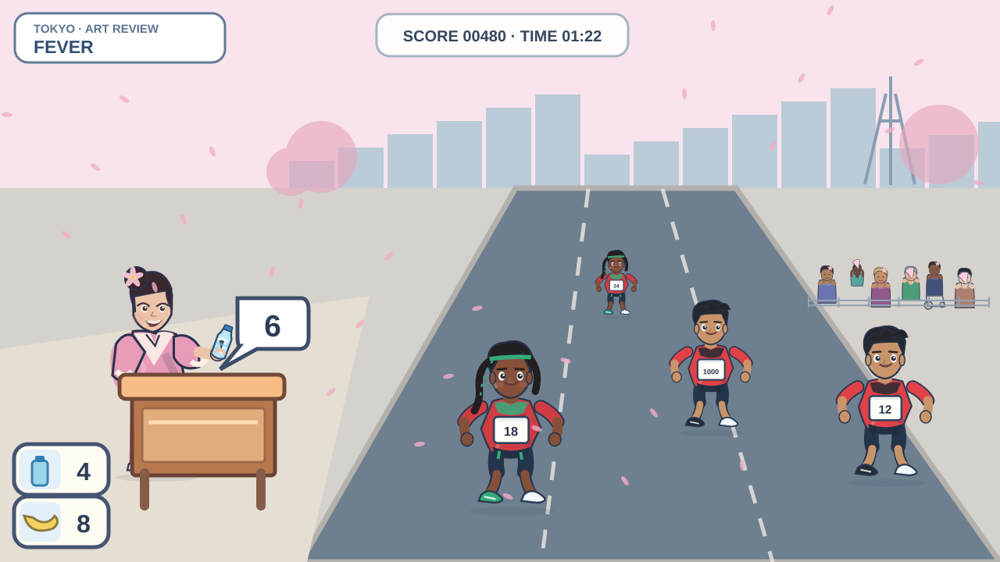
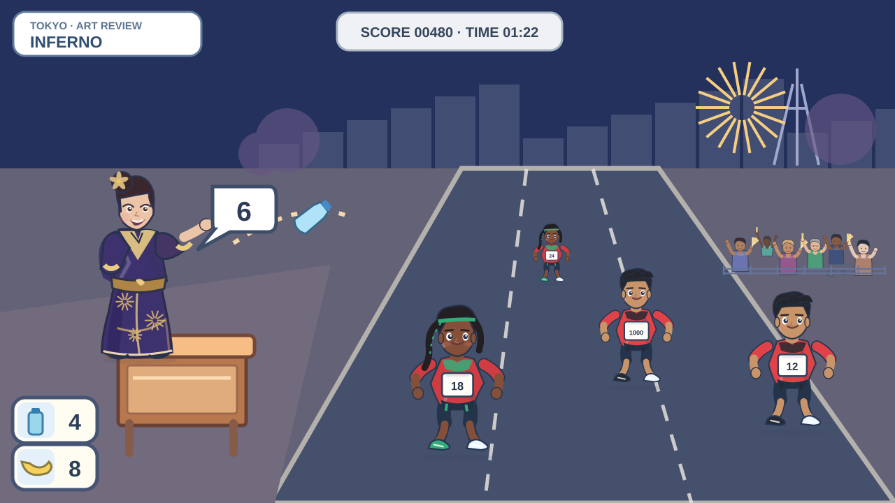
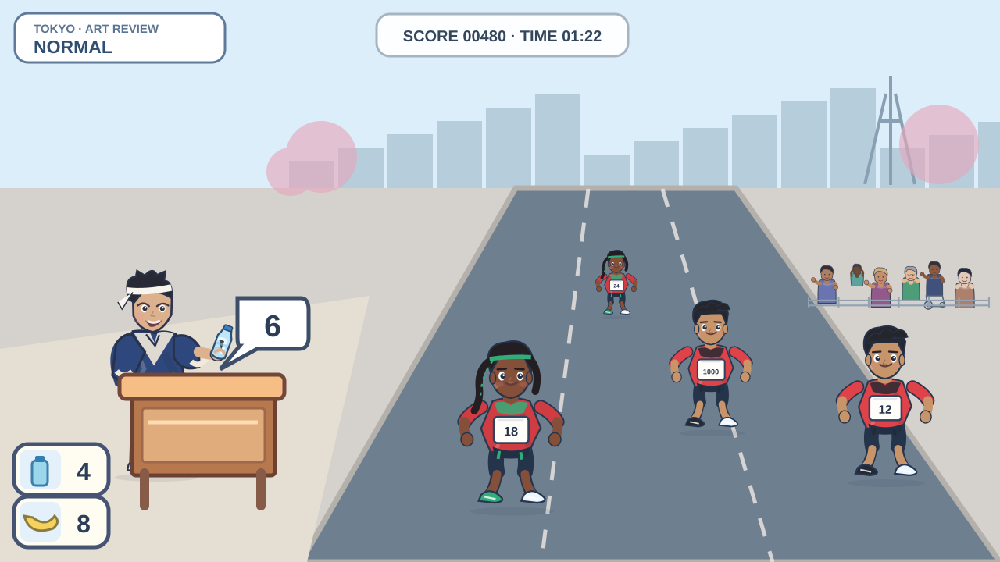
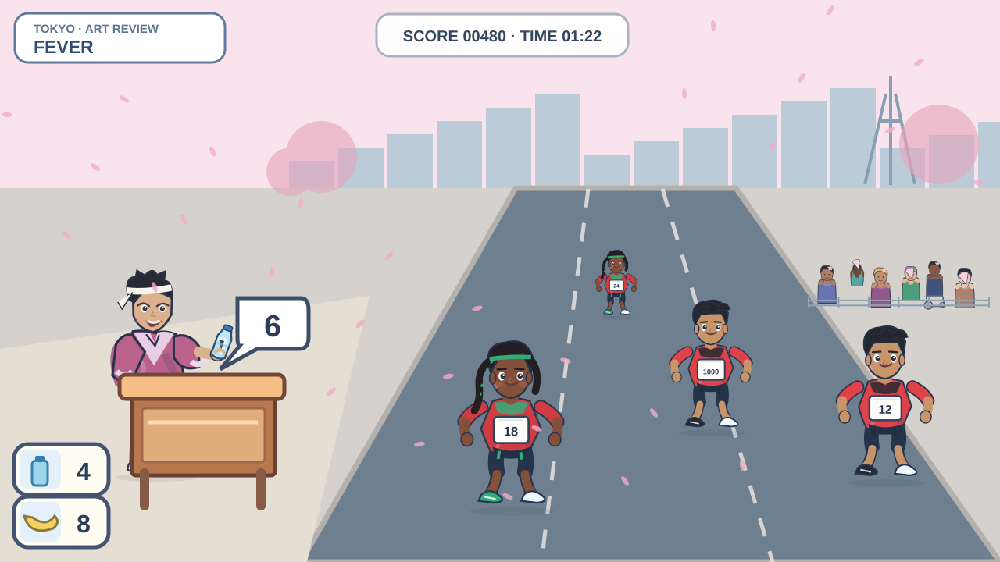

# SnackDash V2 — Steps 05–08 (r02) visual review pack

**Base:** main2. **Branch:** feature/main2-steps05-08-assets-r01. **Status:** review; not merged, approved, tested, or integrated into game code.

These are actual self-contained editable SVG vector art assets. Transparent source SVG components are separated from composited 1280×720 review sheets. They are not PNG sprite atlases and must not be described as gameplay-tested production exports.

## Character casting and costume sheets

- [22 runner concepts — female](runner_cast_female_r02.svg) · [male](runner_cast_male_r02.svg)
- [Tokyo male and female / Normal, Fever, Inferno — six costumes](tokyo_volunteer_6_costumes_r02.svg)
- [Tokyo crowd — three persistent-mode groups](tokyo_crowd_3_modes_r02.svg)
- [Female climb / release / descent storyboard](tokyo_female_inferno_storyboard_r02.svg) · [Male storyboard](tokyo_male_inferno_storyboard_r02.svg)

## Six landscape gameplay review frames (1280×720)

| Normal | Fever | Inferno |
|---|---|---|
|  |  |  |
| [Full size](tokyo_female_normal_gameplay_r02.svg) | [Full size](tokyo_female_fever_gameplay_r02.svg) | [Full size](tokyo_female_inferno_gameplay_r02.svg) |
|  |  |  |
| [Full size](tokyo_male_normal_gameplay_r02.svg) | [Full size](tokyo_male_fever_gameplay_r02.svg) | [Full size](tokyo_male_inferno_gameplay_r02.svg) |

- [Eight-runner four-digit reading stress frame](tokyo_eight_runner_stress_r02.svg)
- [Machine-readable QA report](qa-report-r02.json)

## Asset folders and counts

| Step | Assets provided | Review status |
|---|---|---|
| 05 | 22 editable runner masters, 176 run-loop SVG frames, 22 bottle catch poses, 88 additional reaction faces | review |
| 06 | Six Tokyo staff outfits and two independent avatars | review |
| 07 | 50 staff action keyframe SVGs and JSON anchor/duration files; run-loop JSON for each runner | review |
| 08 | 18 transparent crowd groups by three modes, three depths and two sides; three festival overlays | review |

Open source indexes: [runner](../../source/runner/casting-index-r02.json), [staff](../../source/volunteer/tokyo/character-index-r02.json), [crowd](../../source/crowd/tokyo/crowd-index-r02.json).

## Visual invariants for approval

- All six composites use the same short table and three-lane camera.
- Normal and Fever staff stand behind the table. Inferno staff occupy its existing tabletop; long female kimono hides legs.
- Hand-side bubble has only a number (6; 13 in stress preview), not an icon. The two reserve slots have a physical item and their own numbers.
- Runner bibs are blank in source assets; digits 18, 1000, etc. are a separate compositing layer in review only.
- The held bottle is separated from the runner/bottle attachment data; staff release hands are empty in flight.
- Nationality/profile and visual appearance are independent at runtime. These 22 people are representative fictional casting examples only.

## Not yet completed

Awaiting review acceptance/revisions, layer cleanup, PNG/WebP export and atlas packing, measured animation pivots, timing/event checks, real-device readability, visual quality comparison against the approved Tokyo image, and a future *separately confirmed* gameplay integration. The other nine cities follow the Tokyo-first rule in the playbook, rather than counting as produced in Step 08.

References: [r02 playbook](../../../docs/SnackDash_V2_Landscape_Asset_Playbook.md) · [approved prior Tokyo visual](../../references/tokyo-confirmed-r01.png) · [asset provenance](../../references/production-provenance-r02.md).
