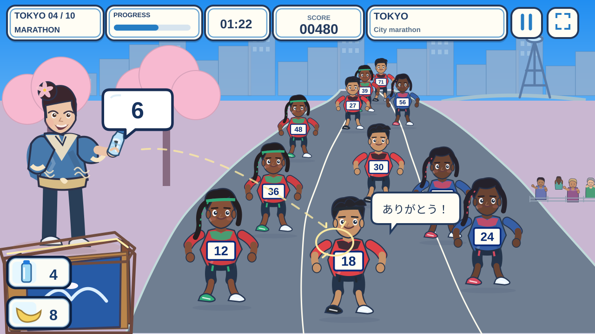
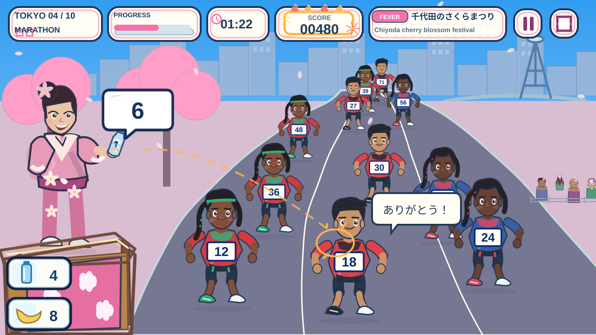
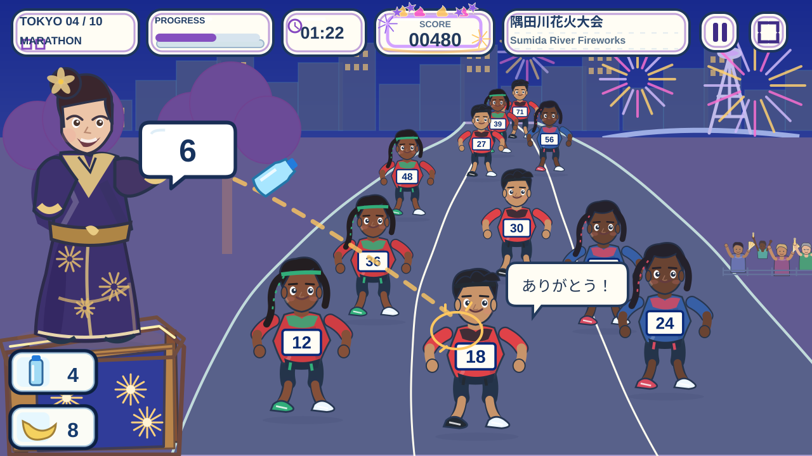
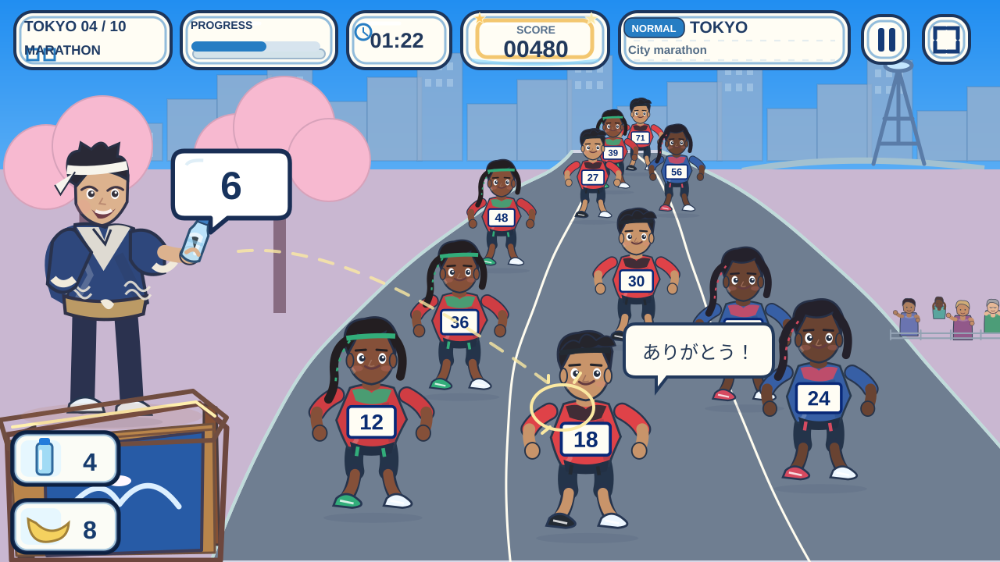
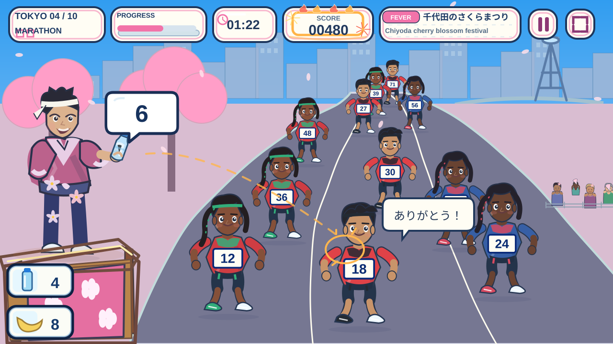
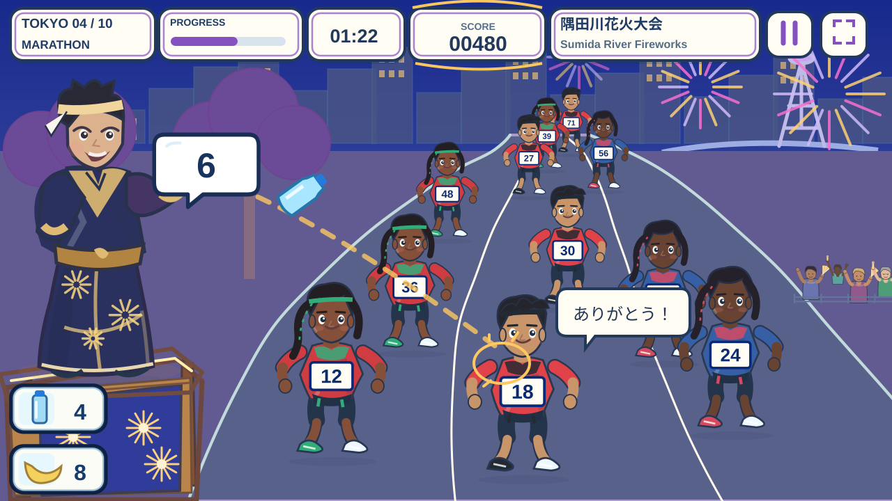

# SnackDash V2 — Tokyo Steps 09–10 art-review pack (r03)

**Status: REVIEW.** Source geometry from owner-approved Tokyo Normal / Fever / revised Inferno reference images. Preview SVGs are editable *technical compositions*, not new owner-approved finished visuals or gameplay-integrated assets. Ancestor branch `feature/main2-landscape-assets-r02`; review head `feature/main2-steps05-08-assets-r01`. Original 1–4 approved visual references and derived r03 camera/station/supply sources are present on the same branch (copied unchanged from the dedicated earlier art branch).

**Step 05 r03 runner update:** These six technical Step 10 images still embed the *earlier* r02 runner drawings. They have NOT been regenerated or approved with new r03 runner source. See [new cast and bib studies](../steps05-08/README.md); do not use older embedded numerals for new bib approval.

## Start here: full 1280×720 landscapes

| Normal | Fever | Inferno |
|---|---|---|
|  |  |  |
| [Full image](tokyo_female_normal_full_r03.svg) | [Full image](tokyo_female_fever_full_r03.svg) | [Full image](tokyo_female_inferno_full_r03.svg) |
|  |  |  |
| [Full image](tokyo_male_normal_full_r03.svg) | [Full image](tokyo_male_fever_full_r03.svg) | [Full image](tokyo_male_inferno_full_r03.svg) |

[Female three-mode contact](tokyo_female_three_modes_approved_camera_contact_r03.svg) · [Male three-mode contact](tokyo_male_three_modes_approved_camera_contact_r03.svg)

## Step 09 — visual FX and audio cues

- [12 event FX peaks across three modes](fx_event_peak_contact_r03.svg)
- [Inferno combo ignition/keyframe strip — normal vs reduced](inferno_combo_normal_reduced_keyframes_r03.svg)
- Animated SVG review: [normal motion](tokyo_inferno_combo_animated_normal_r03.svg) · [reduced motion](tokyo_inferno_combo_animated_reduced_r03.svg). Browser/GitHub preview may show the static fallback if SMIL timing is unsupported.
- [Fever motion contrast](tokyo_fever_motion_comparison_r03.svg) · [Inferno motion contrast](tokyo_inferno_motion_comparison_r03.svg)
- [SVG FX source index](../../source/fx/tokyo/fx_index_r03.json) (48 review masters including six city ambient variants; seven event types × three modes × two motion policies; 168 illustrative motion-keyframe SVGs).
- [Five original dry WAV files](../../source/audio/cues/manifest_r03.json): supply swap, receipt, Fever entry, Inferno entry, soft miss. WAV PCM mono 16 kHz 16-bit; no licensed samples, not loudness-mastered or phone-tested.

## Step 10 — empty UI skins, native text and readable arithmetic

- [30 editable blank UI components](../../source/ui/tokyo_v2/ui_components_index_r03.json) with [layout/anchor JSON](../../source/ui/tokyo_v2/layout_r03.json).
- [Correct 6 ➜ 18 vs incorrect 6 ➜ 10](tokyo_correct_vs_wrong_review_r03.svg)
- [13 in held-number bubble + 1000 bib + 8 visible runners](tokyo_stress_13_and_1000_8_runners_r03.svg)
- [Tokyo staff choice independent of locale](tokyo_staff_selection_i18n_independent_r03.svg)
- [CJK, Latin, native athlete reactions, and long event-name text](multiscript_festival_and_reaction_typography_r03.svg)
- [640×360 Inferno thumbnail](femaleinferno_thumbnail_640x360_r03.svg) · [640×360 stress thumbnail](stress_thumbnail_640x360_r03.svg) · [19.5:9 side extension](tokyo_fever_wide_19_5x9_center_unchanged_r03.svg) · [4:3 letterboxed example](tokyo_fever_narrow_4x3_letterbox_r03.svg)

## What is intentionally independent

- The exact owner-approved high-angle left-bending **road geometry** is drawn from `assets/source/approved-rebuild-r03/camera/approved_road_geometry.svg`. Runner screen positions, 7 eligible target region and continuous size policy follow `approved_camera_coordinates.json`.
- The fixed 1280×720 **table and seasonal fascia** come from the r03 `station/tokyo` vectors; one unchanged tabletop contact is used in all modes. Normal/Fever are behind the table; Inferno volunteer stands on it. The art shows pose prototypes only, not measured animation playback.
- Seven HUD skins per mode have been inlined from the individual `assets/source/ui/tokyo_v2/{mode}/*.svg` components. Dynamic numerals, native athlete short speech, festival native title and player-language explanation remain separate overlay groups. The independent asset masters contain no variable game strings.
- Hand-number bubble contains only one digit sequence and never a second item picture. Lower-left has exactly two fixed backup cells with one physical icon and number each. The thrown item remains a bottle. Overlay FX is placed below the bib/HUD/hand-number text layers.
- Original festival names (Fever `千代田のさくらまつり`, Inferno `隅田川花火大会`) are *working candidate names* taken from the playbook. The English explanatory subtitles are provisional review labels, not verified official translations.
- Short athlete reactions `ありがとう！` and `痛い！` are test strings from the existing `feature/i18n-foundation/src/js/reactions.js`; no runtime language content or identity mapping was changed.

## QA / limitations

Review [per-step QA register](qa-report-r03.json). Source-file checks confirmed the presence of independent approved road, table, exactly two reserve UI elements, a single number-only bubble and separate text in sampled compositions. **This is structural inspection, not visual sign-off.** On-device legibility, drawing/occlusion quality, audio listening, runtime event sync, touch/selection, FPS, browser compatibility, atlas packing, production raster exports and exact aesthetic match to approved art all remain pending. Steps 11–12 and gameplay integration are separate future work and require the user's prior approval for any source-code changes.
