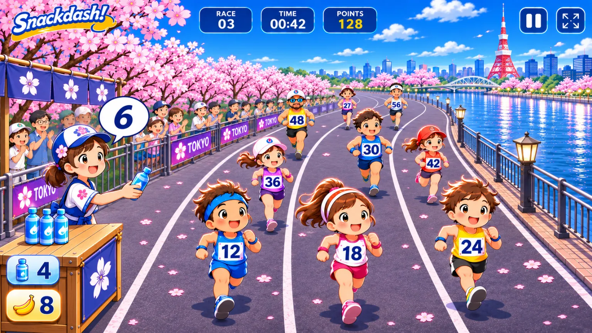
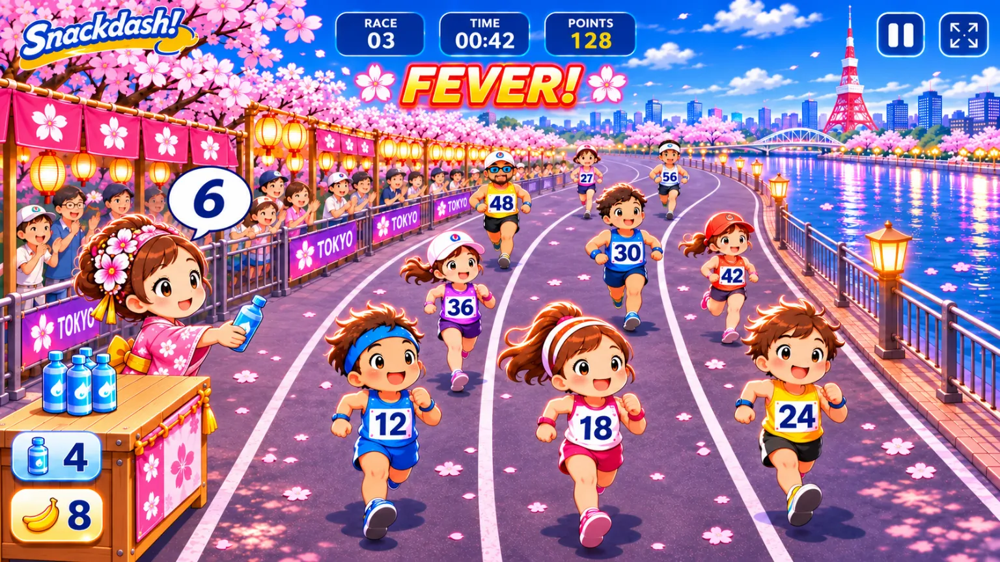
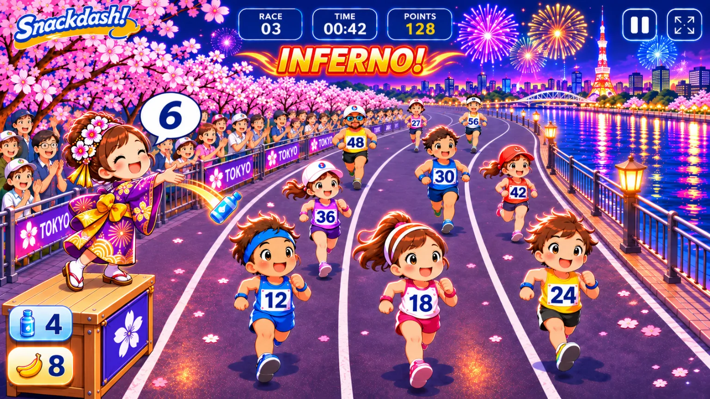

# SnackDash — Tokyo approved visual references (r02)

**Owner approval: 2026-11-27** · **Normal / Fever / Inferno** · **Visual direction approved; runtime assets not yet built**

The owner supplied **three complete reference images** and explicitly approved the **camera, perspective, road curvature, relative sizes of runners/volunteer/table/supplies, position, actions, visual style and mode-specific effects**.

[View the three originals side by side in the approved reference gallery](https://chatgpt.com/space/page_47596f3a8a2881918ad2bd9b7bed05f5)

> **Binary transfer status: COMPLETE.** All three original images are committed below as unchanged WEBP files with the original SHA-256 values; they are the approved visual reference baselines.

## Original approved screenshots

### Normal

### Fever

### Inferno (revised 2026-11-27)

## Approved image inventory

| Mode | Exact intended repository filename | Original dimensions | SHA-256 |
|---|---|---|---|
| Normal | `tokyo_normal_approved_r02.webp` | 1536 × 865 | `ce4fb734618ad0ea2676602e3ad41afdb02c184ed6a0fb46fae31f6d4788e3cb` |
| Fever | `tokyo_fever_approved_r02.webp` | 1536 × 864 | `162a4aaac4f918595f3e63cffa601fac95b2a1f1545b144fc3dc90a61c0c8551` |
| Inferno | `tokyo_inferno_approved_r02.webp` | 1536 × 864 | `024d87c27f60545af4518e307432b5e9585b33e3265fd0a4c2e6d28a77bd3bc1` |

> **Inferno replacement (2026-11-27):** The owner-provided `1000084030.png` is now the approved Inferno source. The preceding `1000084014.png` version has been superseded, remains available in Git history (commit `3efd1b3`), and must not be treated as the current reference. Normal and Fever are unchanged.

Original user filenames end in `.png` but the binary headers are **WEBP**. Preserve bytes and SHA-256 when transferring to GitHub; use the `.webp` extension. See [manifest](./manifest.json).

## Shared approved art direction

- **Landscape camera**: elevated high-angle camera with a smooth **left-bending** road and a longer usable approach; the right side reveals open river, skyline, bridge and the prominent tower as depicted.
- **Main runner field**: chibi / big-head adult-looking runners with visible large bib numerals. Approximately **6–7 runners** are the intended selectable set at a time, while additional visible runners can be present farther along the course. Their apparent sizes must follow **one continuous perspective scale**, not a discontinuous jump at the clickable boundary.
- **Natural staging**: the active runners have varying depths, uneven spacing, running phases and lateral positions; no artificial seven-runner military formation.
- **Aid station perspective**: the left foreground physical table has consistent height, thickness, depth, legs and facing panels. The volunteer's body must not intersect the tabletop.
- **Normal and Fever**: volunteer stands **behind** the aid table and reaches over/around its surface to offer or throw a single physical supply item. Lower body is correctly occluded by the fixed table.
- **Inferno**: the volunteer stands **on the same table**, with actual foot/robe contact and a higher throwing position. No sudden swap to an elevated stage or different table geometry.
- **Inventory/UI**: exactly two reserve slots at lower-left, each with item icon and numeric quantity. The white hand-side bubble contains **only one numeric value** and no repeated bottle/banana/gel art.
- **Mode progression**: preserve each reference's own outfits, decorations, lighting and festival FX, without altering camera/scale geometry.

## Precedence and handoff

These three owner-supplied images are the **approved visual baseline**. Earlier `assets/previews/landscape-r02` vector camera A/B sketches and other experimental renders are exploration only and **not a substitute** for these approved samples.

A later implementation can separate layers, create depth-aware hitboxes and sprite animations, and perform geometric QA. It must not change the approved composition or assume this reference art is ready to be used as a single flattened runtime asset.

No gameplay source code was modified by this reference-archival update.
